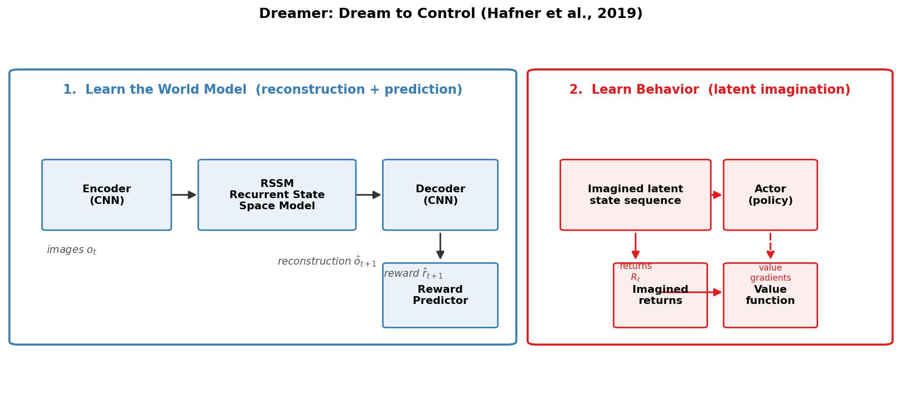
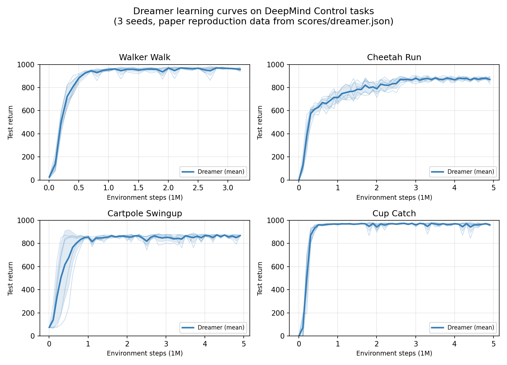

# Dreamer：基于模型的强化学习（TensorFlow 2 简洁实现）

> **Dream to Control: Learning Behaviors by Latent Imagination**
> Danijar Hafner, Timothy Lillicrap, Jimmy Ba, Mohammad Norouzi — 2019
> 论文：[arXiv:1912.01603](https://arxiv.org/pdf/1912.01603.pdf) ｜ 官方实现（TF1）：[google-research/dreamer](https://github.com/google-research/dreamer)

[](https://www.tensorflow.org/)
[](https://www.python.org/)
[](LICENSE)
[](https://arxiv.org/abs/1912.01603)

本项目是 **Dreamer** 算法的 TensorFlow 2 简洁实现：一个基于模型的强化学习（Model-Based RL）智能体，通过**在紧凑的隐空间中"做梦"**——想象未来的轨迹——来高效学习长时域策略。代码结构清晰、易于阅读和二次开发。

---

## 算法原理

Dreamer 的训练分为两个阶段：

1. **学习世界模型（World Model）**：用循环状态空间模型（RSSM）在紧凑的隐空间中预测未来。观测图像经 CNN 编码器压缩为隐状态，再由 RSSM 滚动预测，最后通过解码器重建图像、预测奖励——让模型"看懂"环境的规律。
2. **通过想象学习行为（Behavior Learning）**：在世界模型内部（不与环境交互）展开想象的隐状态序列，训练策略（Actor）和价值函数（Value），并将**价值梯度穿过多步想象反向传播**，高效学习长时域策略。



## 特性

- **简洁高效**：单文件核心实现，代码量小，易于阅读与修改
- **TensorFlow 2 + 混合精度**：默认 FP16 混合精度训练，GPU 友好
- **即开即用**：支持 DeepMind Control（MuJoCo）与 Atari 环境
- **完整实验工具链**：内置 TensorBoard 可视化与论文风格绘图脚本
- **可复现**：附带 `scores/` 目录中的论文复现数据与基线对比数据

## 环境要求与安装

```bash
pip3 install --user tensorflow-gpu==2.2.0
pip3 install --user tensorflow_probability
pip3 install --user git+git://github.com/deepmind/dm_control.git
pip3 install --user pandas
pip3 install --user matplotlib
```

> 本机开发环境（conda）：`D:\conda\conda_envs\dreamer`（Python 3.7 + TensorFlow 2.6）

## 快速开始

### 1. 训练智能体

```bash
python3 dreamer.py --logdir ./logdir/dreamer/1 --task dmc_walker_walk
```

首次运行会先收集 5000 步随机数据（prefill），随后开始"练习 + 做梦"的循环，每 1 万步自动保存一次模型检查点（`variables.pkl`）。

### 2. 查看训练结果（TensorBoard）

```bash
tensorboard --logdir ./logdir
```

浏览器打开 `http://localhost:6006`：

- **SCALARS**：`train/return`（练习得分）、`test/return`（考试得分）曲线
- **VIDEO**：测试时智能体的实际表现录像
- **IMAGES**：世界模型的图像重建效果

### 3. 生成论文风格对比图

```bash
python3 plotting.py --indir ./logdir --outdir ./plots --xaxis step --yaxis test/return --bins 3e4
```

## 效果展示

在 DeepMind Control 基准任务上，Dreamer 通常在约 10 万环境步内快速学会任务，50 万步后接近收敛（满分 1000）：



| 任务 | 最终得分（约） | 参考基线 |
|------|--------------|----------|
| Walker Walk | ~870 | D4PG 968 / PLANet 951 |
| Cheetah Run | ~800+ | SLAC 880 / PLANet 662 |
| Cartpole Swingup | ~875 | D4PG 862 / PLANet 821 |
| Cup Catch | ~950+ | D4PG 980 / PLANet 930 |

## 项目结构

```
dreamer-TensorFlow 2/
├── dreamer.py          # 主入口：配置、智能体、训练/评估循环
├── models.py           # 网络定义：RSSM、CNN 编码/解码器、策略/价值网络
├── tools.py            # 工具：数据存取、λ-return、分布、Adam、调度器
├── wrappers.py         # 环境包装：DMC/Atari、ActionRepeat、异步并行等
├── plotting.py         # 论文风格绘图（学习曲线 + 基线对比）
├── scores/             # 论文复现数据与基线分数（绘图对比用）
├── logdir/             # 训练输出：模型检查点、指标、TensorBoard 日志
├── episodes/           # 旧版训练的 episode 数据
└── assets/             # README 配图（可运行 make_figures.py 重新生成）
```

## 训练成果说明

运行训练后会得到哪些成果文件、放在哪里、各有什么作用，详见 [训练成果说明.md](训练成果说明.md)。

## 引用

如果您在研究中使用了本代码，请引用原论文：

```bibtex
@article{hafner2019dreamer,
  title={Dream to Control: Learning Behaviors by Latent Imagination},
  author={Hafner, Danijar and Lillicrap, Timothy and Ba, Jimmy and Norouzi, Mohammad},
  journal={arXiv preprint arXiv:1912.01603},
  year={2019}
}
```

## 许可

本项目基于 [MIT License](LICENSE) 开源。
